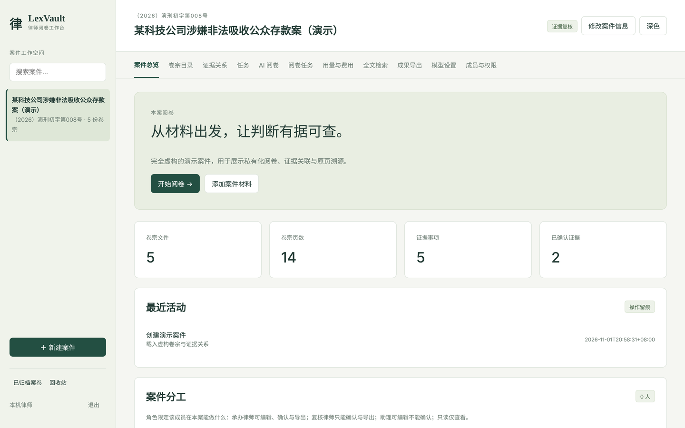

# LexVault — local legal document review

LexVault is a local document review workbench built with **FastAPI/Python** and a **Next.js/React/TypeScript** interface. It connects answers to source pages and keeps case access, audit records, model egress controls, bounded read-only tools, and answer validation on the Python backend. Legal conclusions require qualified human review.



## Results at a glance

Each row links to the details and how to reproduce them.

| Question | Answer |
|---|---|
| Do specialist handoff and cross-review improve answers? | **No.** Paired runs on a local 27B model: holdout pass rates A/B/C 90.3% / 88.9% / 87.5%, while B/C use 4.9–6.4× the input tokens, so cross-review stays off ([record](docs/history/migration/portfolio-p2-holdout-results-20261028.md), Chinese) |
| Does the statute corpus help? | LawBench, 1,000 paired questions: 58.81% → 62.49% (+3.68 pp, 95% CI [+2.76, +4.69]) ([record](docs/benchmarks/corpus-rebuild-paired-20261024.md), Chinese) |
| Can resume reuse stale analysis? | No: editing one source page makes resume refuse, without consuming a retry ([demo](docs/history/migration/portfolio-p3-demo-status-20261027.md), Chinese) |
| Can a prompt or model change silently make answers worse? | A 60-question answer-quality gate runs on every push; fixing what a real model got wrong moved it from 51 to 57/60, and the gate caught a regression on the way ([record](docs/history/eval-gate-model-baseline-20261102.md), Chinese) |
| Can it run on an enterprise database? | The same code runs on SQLite and PostgreSQL + pgvector; vector search over 10,000 pages drops from 1.29 s to 48 ms with the same results ([benchmark](docs/benchmarks/postgres-vector-search-20261102.md)) |
| Can people be kept out of a conflicted matter? | An information wall enforced twice, in the application and by PostgreSQL row-level security; with the application check off nothing leaks, while SQLite leaks through 10 endpoints ([runbook](docs/runbook/case-walls.md), Chinese) |
| Can a new matter be checked for conflicts? | A hit locks the case until another partner approves it with a written reason; a hit on a walled case only says a conflict exists ([runbook](docs/runbook/conflict-check.md), Chinese) |
| Engineering | Offline tests: 1,757 on Python 3.11 and 3.14 each and 1,772 on PostgreSQL, all passing, about 87% coverage; ruff, mypy and a Docker smoke test in CI ([quality baseline](docs/portfolio/project-brief.md), Chinese) |

Not done yet: independent human labels (a two-reviewer blind package is ready), a recorded real-model demo, cross-model comparison, and law-firm business sign-off. Samples are small and synthetic; read the [project brief](docs/portfolio/project-brief.md) (Chinese) for exact scope.

Development: the maintainer owns direction, experiment design, acceptance criteria and trade-offs; much of the code was written with AI coding assistants (Codex, Claude).

## Run locally

Use Python 3.11–3.14, the Node version in `frontend/.node-version` (24.22.1), and pnpm 11.25.0. Install `uv` 0.12.0 and document parsing/OCR tools as described in the [Chinese setup guide](README.md).

```sh
uv sync --locked --group dev
pnpm --dir frontend install --frozen-lockfile
pnpm --dir frontend build:static
./run.sh
```

Open `http://127.0.0.1:8765`. FastAPI serves the static UI and API from the same origin; Node is needed for development/builds. The application does not implicitly load `.env`. Inject configuration explicitly using the safe examples in `.env.example`. Local mode retains its loopback restrictions; shared access requires configured token/OIDC authentication.

Model functions require an explicitly configured compatible local endpoint and an actual model ID. Remote model access is disabled by default. Offline rule summaries and fixed-answer test doubles are distinct from real model results. Scan support requires working parsers/OCR and a separate quality evaluation.

## Capabilities and checks

- Case/document management, source preview, evidence annotations and exports.
- SSE answer drafts, validation/retraction, citations and idempotent retry.
- Native DAG/LangGraph workflows, checkpoints, read-only tools, traces and optional model fallback.
- Usage, latency and estimated costs with unknown/partial observations preserved.
- A frozen 60-question synthetic answer regression set, strict optional judge and a digest-bound 20-item blind review workflow.

```sh
uv run --locked ruff check app tests scripts
uv run --locked mypy
uv run --locked python scripts/build_answer_eval.py
pnpm --dir frontend contract:check
pnpm --dir frontend typecheck
pnpm --dir frontend lint
pnpm --dir frontend test
pnpm --dir frontend build:static
pnpm --dir frontend test:e2e
```

Full offline checks, dependency export parity and coverage follow `.github/workflows/test.yml`. Use isolated synthetic data for tests. M2 integration needs the separately installed, pinned Python 3.12 framework environment; a skipped integration is not a pass.

## Demo and evidence

See the [frontend runbook](docs/runbook/frontend.md), [MCP acceptance](docs/runbook/mcp-acceptance.md), [answer review guide](docs/runbook/answer-evaluation.md), and [execution record](docs/history/migration/ai-application-upgrade-followup-execution-20261025.md).

The recording script `node frontend/scripts/record-demo.mjs --output output/new-demo` starts an isolated FastAPI instance and fixed-answer model test doubles. It records a silent, captioned three-minute workflow. Install the Playwright FFmpeg dependency first (`pnpm --dir frontend exec playwright install ffmpeg`) and set `LEXVAULT_BROWSER_PATH` when using an existing Chromium-family browser. The recording is explicitly labelled synthetic and is not evidence of real model accuracy.

Independent human labels and judge/human agreement remain outstanding. The 60-question regression set comes from a single synthetic case and is not lawyer-annotated ground truth. Negative results are retained in the execution records.

## License

Released under the [MIT License](LICENSE). Third-party dependencies and datasets (including LawBench, which is not redistributed here) keep their own licenses; see the [license inventory](docs/runbook/licenses.md).
