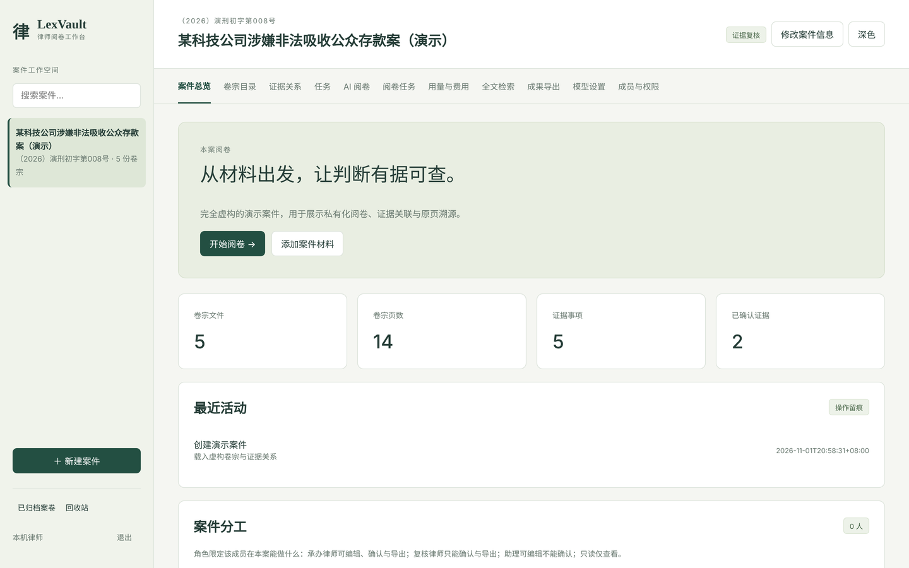
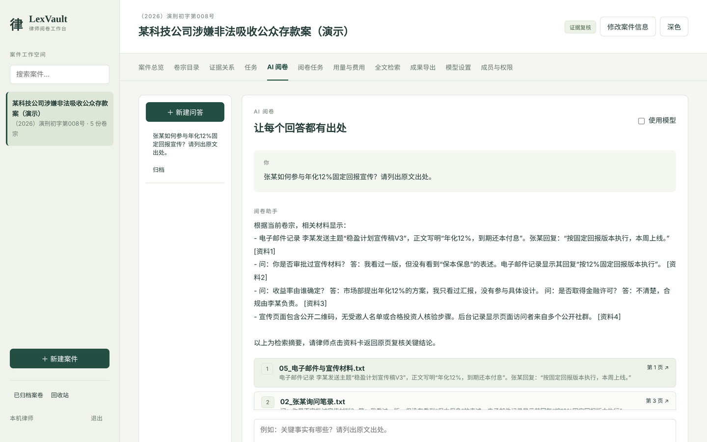
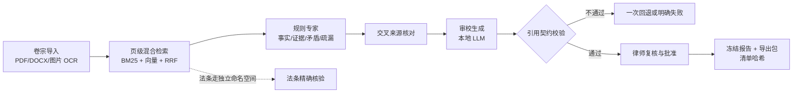

# LexVault：本地优先法律卷宗智能阅卷系统

    

[English documentation](README.en.md)

FastAPI + SQLite / PostgreSQL 的私有化法律阅卷工作台：多格式卷宗导入、页级混合检索、证据管理与审批、可审计的双运行时 Agent 分析。核心设计是**证据优先**——法律检索结果必须能追溯到受控法条语料与案件原文页；法条核验节点无法精确核验时，不提供可核验法条引用。普通聊天的引用检查主要验证格式与来源存在性，不能据此声称语义支持或法律有效性已验证。**AI 输出仅辅助审阅，不能代替律师判断；系统不自动出具法律结论。**

## 30 秒看懂





<sub>截图均为完全虚构的演示案件；第二张关闭了模型，回答由规则检索摘要生成。</sub>

**它做什么**：把“检索 → 多专家结构化交接 → 交叉核对 → 审校生成 → 引用校验 → 人工复核 → 版本化导出”做成一条可恢复、可校验、可对照实验的流水线，而不是一次性的聊天封装。



**关键结果**（全部可从仓库与私有产物复算，口径见[项目说明](docs/portfolio/project-brief.md)）：

| 问题 | 实测 |
|---|---|
| 多专家结构化交接与交叉审校是否让回答更好？ | 在本机 Qwen3.8-27B（4-bit）上同题配对：开发集 60 题 A/B/C 通过率 86.7% / 76.7% / 86.7%，六案例保留集 24 题 × 3 轮 90.3% / 88.9% / 87.5%；B/C 输入 token 是 A 的 4.9–6.4 倍。**没有观察到收益**，因此默认不开启交叉审校。 |
| 法条库对模型有多大帮助？ | LawBench 同题配对（4-bit，1,000 题）：混合均分 58.81% → 62.49%（+3.68 pp，95% CI [+2.76, +4.69]），其余 18 项逐题不变。 |
| 断点恢复会不会复用过期分析？ | checkpoint 记录每页原文摘要：未改动时独立进程恢复、专家节点不重跑；改动一页后拒绝恢复且不消耗重试次数。 |
| 改提示词、检索或换模型会不会悄悄变差？ | [答案质量门禁](docs/runbook/eval-gate.md)：60 题冻结评测集走真实对话路径、逐题评分，与已登记基线比较，CI 每次推送运行。故意让检索只保留第 1 页，门禁拦下并列出退化的题号。本机 Qwen3.8-27B 首轮 51/60；按它的失败题修了两处上下文定位和回答长度、拒答引用后，第二轮 57/60，截断与被契约拒绝的回答都降为 0；剩下 3 题复核为评分词表没认出的正确拒答，评分升为 v3 后用保存的回答重新评分为 60/60（新增措辞取自这两轮，属样本内）。修改过程中门禁还拦下了一处顺带引入的退化（[记录](docs/history/eval-gate-model-baseline-20261102.md)）。规则模式 46/60。 |
| 能不能换成企业数据库？ | 设置 `LAW_REVIEW_DATABASE_URL` 即切到 [PostgreSQL + pgvector](docs/runbook/postgresql.md)，同一套代码；全量测试在两种数据库上都跑，门禁 60 题两库逐题结果一致。10,000 页单案向量检索 p50 从 1.29 s 降到 48 ms，前 20 页完全相同（[基准](docs/benchmarks/postgres-vector-search-20261102.md)）。 |
| 同一律所代理有利益冲突的案件，能把无关的人挡在外面吗？ | [信息隔离墙](docs/runbook/case-walls.md)：设墙案件只有墙内名单上的人能看到，管理员也不例外，墙外的人看到的效果与案件不存在相同；破窗访问限 30 分钟、须写理由并留痕。除应用层检查外，PostgreSQL 上 33 张表启用强制行级安全：测试关掉应用层检查后遍历全部 GET 接口，墙内标记一次都没出现，同样操作在 SQLite 上有 10 个接口泄露。五分之四材料对当前身份隐藏时，10,000 页向量检索 p50 120 ms（不受限对照 56 ms），没被挡的用户 68 ms，结果相同（[基准](docs/benchmarks/postgres-rls-overhead-20261102.md)）。 |
| 工程质量 | 全量离线测试（禁网、隔离数据目录）在 Python 3.14 上 1714 项通过、0 失败，3.11 上 1713 项通过、1 项为已知偶发的评测器超时用例（8 项因私有 LawBench 数据与 Apple 专用 `mlx_lm` 跳过，12 项 PostgreSQL 专项在此跳过），综合覆盖率约 86.8%；同一套测试在 PostgreSQL 上 1725 项通过、0 失败；法条核验模块覆盖率 100%；核心接口声明响应模型，前端使用生成的类型；ruff（E9/F/I/UP/B）与 mypy 门禁；Docker 构建与 HTTP 冒烟在 CI 中执行。 |

**没做到的**也写在明处：独立人工评分（双人盲标注包已备好）、真实模型主演示视频、跨模型对照、律所业务签收。

**开发方式**：维护者主导方向、实验设计、验收标准与结果取舍，编码大量借助 AI 编程助手（Codex、Claude）完成。按 [MIT 许可证](LICENSE) 开源。

**快速体验（无需模型）**：

```bash
python3 -m pip install uv==0.12.0 && uv sync --locked
pnpm --dir frontend install --frozen-lockfile && pnpm --dir frontend build:static
./run.sh   # 打开 http://127.0.0.1:8765，内置演示案件；在「AI 阅卷」关闭「使用模型」即可离线体验检索与引用定位
```

更完整的演示：[合成旧库迁移、复核签发与备份恢复](docs/runbook/migration-demo.md)（可复现命令与五分钟讲解顺序，无需真实卷宗或模型服务）。

## 1. 项目定位

当前默认策略与实验边界见 [2026-09-14 策略基线](docs/architecture/strategy-baseline-20260914.md)，后续优化以该基线开展对照。

| 适合 | 不适合（当前版本边界） |
|---|---|
| 单组织、单实例、受控设备的本地/内网部署 | 多实例高并发、多租户 SaaS |
| 有明确使用授权的卷宗数字化与证据整理 | 对外提供法律意见或法条依据（法条引用功能未达验收） |
| 律师主导、AI 辅助的人机协同流程 | 无人复核的全自动决策 |

当前版本 **v0.4.0**。发布序列：`v0.1.0` 工程基线 → `v0.1.1` 首个 CI 全绿 → `v0.2.0` 治理批次（权限矩阵、OIDC、证据链、审计事件、容器化、供应链扫描）→ `v0.3.0` 可验证源码包与合成案件部署验收 → `v0.4.0` Next.js 前端、多人协作（成员分工、人工任务、报告签发）、三组对照评测、本机五人技术试点，以及代码质量整理（接口按领域拆分、lint 与类型门禁、MIT 许可）。`v0.3.0` 及之前的标签属于 2026-10-23 之前的旧提交历史。接收者的安装与验收入口见[交付指南](docs/runbook/delivery.md)；版本历史见[企业化改进报告](docs/runbook/enterprise-improvement-report.md)第 10–11 节。

### 1.1 仓库结构

```text
app/          产品代码：生命周期与中间件（main.py）、按领域划分的接口（routes/）、Agent 双运行时、检索、语料、权限与审计
frontend/     Next.js + React + TypeScript 正式界面，静态构建后由 FastAPI 同源托管
tests/        离线自动化测试（CI 禁网运行）
benchmarks/   评测数据集与历史实验产物（LawBench 上游数据、结果 JSON）
scripts/      发布、运维与维护工具（环境自检、备份、语料构建、发布打包）
docs/         架构说明、运维手册、评测口径与求职材料；过程记录归档在 docs/history/

unified_benchmark_runner.py   模型评测公开入口
rag_project_benchmark.py      项目 RAG 页级检索回归入口
verify_benchmark_run.py       评测产物完整性与评分复算校验
compare_agent_runtimes.py     双运行时对比入口
BENCHMARK_TEST_PLAN.md        评测验证计划
```

评测**入口脚本有意保留在根目录**，由 `.gitignore` 白名单与[发布白名单](scripts/package_release.py)显式维护，使公开发布入口一眼可见；评测**数据与产物**则归入 `benchmarks/`，避免把可执行代码混入评测资产树。这是设计结果，不是历史残留。

`data/`、`models/`、`output/` 是本地运行边界（数据库、上传、导出、模型权重与实验产物），永不入库。

## 2. 能力总览

| 领域 | 能力 | 明确边界 |
|---|---|---|
| 卷宗导入 | PDF/DOCX/TXT/图片；扫描件本机 Tesseract OCR；页级存储 | 解析预算：单文件 50MiB、PDF ≤500 页、提取文本 ≤5M 字符（超限明确截断标注） |
| 检索 | 全文（SQLite FTS5/BM25，或 PostgreSQL tsvector）+ 法律词项 + 本地向量，RRF 融合；页级引用溯源 | 模型 embedding / reranker 不可用时明确失败；hashed-local 为显式离线路径 |
| 法条核验 | 显式法名/条号在受控法条语料中精确核验，附版本、来源与正文；无法唯一核验时拒答并标记待核验 | 法条语料为受控部署资产（非入库数据）；语料标注不保证现行有效性，有效性仍需律师核验 |
| 证据治理 | 证据/关系/标注 CRUD；原件内容哈希与同案件去重；审批归属，确认内容被编辑后审批自动失效；保存带版本校验，两人同时编辑时后写方得到 409 而不是静默覆盖；改动记录操作者与字段前后值 | 批量操作、软删除尚未实现 |
| 问答与 Agent | 检索路由问答；可选 SSE 流式输出（草稿在校验前可见，未通过引用校验即撤回）；同一会话内可追问（解析指代对象后重新检索，引用只来自本轮），普通聊天、同步 Agent 与后台任务共用会话绑定与冻结快照；原生 DAG（默认）与 LangGraph（可选）双运行时，失败续跑、后台任务轮询；9 个只读工具含回看原文页与法条精确核验，写操作不暴露给模型 | 对象解析为确定性规则；历史与长期记忆是草稿性质，不具已确认事实地位；澄清/资料不足与事实回答分离；恢复不读取更新后的历史 |
| 身份与权限 | `local`（仅回环）/ `token`（Bearer + 逐主体权限矩阵）/ 可选 OIDC 组织登录；服务端不透明会话（8 小时过期、注销吊销）；管理员可添加成员、一次性签发/轮换令牌、分配案件角色，停用成员立即失效其令牌与会话 | 非完整组织级 IAM；无自助改密与外部身份同步，OIDC 真实 issuer 连通属部署验收项 |
| 协作 | 案件信息可修改；材料目录与单页原文可人工纠错，原文纠错使引用不再匹配的“已确认”证据退回待复核；成员目录、案件分工（承办/复核/助理/只读）与角色权限收窄；人工任务可指派到人、设期限、提交、退回（必须写原因）、确认完成，流转留痕；报告具备草稿/待复核/已退回/已批准/已作废状态并绑定材料快照，材料变化后批准自动失效；改动写入字段级审计 | 部署验收按[多人协作首版计划](docs/history/migration/collaboration-first-release-plan-20261027.md)推进 |
| 审计与可观测 | 业务审计、独立 `security_events`（不随案件删除消失）、请求关联 ID、结构化 JSON 日志；逐次模型调用记录 tokens、总延迟与首 token 延迟，缺失值保持未知而非按零计 | 外部独立审计存储（防管理员篡改）待建设 |
| 导出 | 案件包导出附 `清单.json`（哈希、审批状态与报告绑定）；正式交付要求存在**已批准且材料快照未变化**的报告，包内记录报告版本、复核人与批准人 | 导出为人工授权动作，不自动外发；预览包不要求签发 |
| 部署 | 非 root Docker 镜像与 compose（web/worker/redis）；`scripts/data_snapshot.py` 停写备份与恢复；`scripts/collaboration_acceptance.py` 只读验收与备份恢复演练（身份、成员、schema、容量、依据失效） | 未做在线热备、异地复制与自动故障转移；验收脚本不替代律师业务验收 |
| 供应链 | 依赖锁定带哈希、每周 pip-audit + gitleaks 扫描、发布白名单拒绝符号链接 | 扫描为周检，不替代发版前人工审查 |

## 3. RAG 检索策略

LexVault 的检索目标不是单纯提高召回率，而是在法律场景下同时保证四件事：检索结果与案件原文页可对应；法条引用可在受控语料中定位与核验；法律依据与案件事实走不同的检索边界；检索不足时系统不把不确定内容包装成确定结论。

原则是**证据优先**：先确认能取到足够支撑结论的法律依据或卷宗证据，再组织答案。检索按问题性质**分派到不同路径**，而不是把所有资料混入同一个无差别向量库后在末端统一裁剪：

| 路由（`detect_route`） | 检索路径 | 生成 |
|---|---|---|
| 目录统计 | 确定性数据库元数据查询 | 不经模型，直接汇总 |
| 事实检索 / 多文档对比 / 知识库+卷宗 | 案件卷宗页级混合检索 | 普通问答启用模型时，调用或引用校验失败会报错；显式关闭 LLM 时生成规则摘要 |

法条核验是**独立的分析节点**：阅卷编排在问题含法律依据信号（法律、法规、构成要件、规定、法条）时，把「法条核验 Agent」追加进分析计划，与事实、证据、矛盾节点**并列**运行，不汇入案件事实问答的上下文；其核验结果独立呈现并标注待核验。

### 3.1 法条检索与引用安全边界

法律条文与普通知识文档不同：词面相似的段落不构成已核验的法律引用。因此法条侧采用**偏向 fail-closed** 的策略（`app/statutory_retrieval.py`）：

- 问题中显式写出的法名与条号（如《工伤保险条例》第十四条）被解析后，在受控法条语料中做**精确查找**；只有「唯一法名 + 唯一条号 + 语料命中」同时成立，状态才是 `ok`。
- **纯文本检索永远不返回 `ok`**，只返回 `candidate`——语义相近不等于引用成立。
- 显式引用无法唯一解析时（含两部不同法律共用同一简称、条号不存在）返回 `needs_review`，**绝不以相近法条替代**用户所指。
- 同一部法存在多个版本而未指定适用版本时拒绝核验，要求明确版本。
- 语料未配置或完整性校验失败时同样返回 `needs_review`，并在就绪探针 `/api/ready` 报 `legal_verification: unavailable`；语料损坏只降级法条核验，不阻断案件工作区启动。

每条结果都附带 `law_name`、`article_number`、`version_date`、`version_status`、`source_url` 与正文，供律师回看来源。需要明确的是：语料的 `version_status` 标注为 **currentness_not_asserted**——系统保证的是「在受控语料中精确、唯一地定位到某版本条文并标注版本与来源」，**不保证**引用的一定是现行有效法条，有效性判断仍需律师核验。

### 3.2 卷宗证据检索

案件材料走页级混合检索（`app/rag.py`），服务于案件事实、证据与文档内容：

- 关键词通道为 FTS5/BM25 与法律词项 bigram，向量通道为本地 embedding，两路以 RRF 融合（`k=60`，通道权重随查询画像与向量后端自适应）。
- 确定性 hashed 向量后端只作召回通道并把权重压到 0.25，避免其越过精确法律词项、金额或文件名的匹配。
- 命中页扩展相邻页候选后再做候选级重排；模型向量或神经重排请求失败时明确报错，显式离线模式使用 hashed-local 并记录实际后端。
- 回答中的引用卡片与上下文一一对应，可点击回溯到原文页。
- 实验性页内子块模式默认关闭；启用后将最多 400 字、重叠 50 字的子块向量持久化到 SQLite，按页哈希、切分版本和完整 embedding 身份懒重建。热查询复用未变化页面的切分与向量，但词法和向量候选仍逐子块精确扫描，并非 ANN 或持久化倒排索引。

### 3.3 生成与引用校验

生成阶段受检索结果约束：普通问答的模型回答必须通过引用校验（`validate_review_answer`）才会被采纳，否则请求明确失败。显式关闭 LLM 时才走规则摘要路径。Agent 审校节点另有规则汇总及失败诊断逻辑，不应与普通问答的错误契约混为一谈。

法条引用无法核验时返回待核验状态。卷宗检索不足通过检索指标和回答校验暴露，不能仅凭空结果或引用格式合法宣称答案已正确弃答、事实已获支持；语义支撑与法律适用仍需人工复核。

Agent 专家协作使用来源绑定的结构化交接：事实摘录、证据来源与候选矛盾附文档 ID、页码、原文片段和本轮检索快照摘要。审校读取完整发现，不只读取节点摘要；疏漏节点另读取事实与证据的来源对照结果。报告保留候选矛盾和待补证事项，`collaboration` 字段及审校节点轨迹记录完整交接与逐项来源匹配结果。原生 DAG、LangGraph 和 ForgeHarness 隔离候选复用同一交接逻辑。

这里的来源匹配仅表示专家引用与冻结检索片段一致，不证明语义支持、材料真实性、独立印证或律师批准。专家结果缺失、来源未绑定或处于待核验状态时，报告明确标记待复核，不进入长期草稿记忆。旧版 checkpoint 可以读取，但不会推测补齐旧专家的来源绑定。交接上限为 40,000 字符，超限明确失败，不静默删掉分歧；该协作步骤不增加模型或工具调用，继续使用现有运行路径的调用限制。法条核验仍使用独立来源边界，其正文不进入案件事实生成提示。此功能不代表 ForgeHarness 已接入正式产品入口，也不代表法律质量验收已完成。

### 3.4 多轮追问与澄清边界

同一案件的同一会话内支持后续追问（`app/context.py`）：服务端只读取最近 4 个完整问答轮次（合计不超过 4000 字符）用于理解“它/该合同/第 2 份”等指代，按确定性规则解析对象后**重新检索**，引用卡片仍只来自本轮检索片段。历史回答、草稿线索与卷宗文本一样是不可信数据，不是证据，也不参与 `[资料N]` 编号。

- 显式更正（“不是这份，改看……”）优先于历史对象；对象无法唯一确定时返回 `answer_status=clarification` 与候选材料，下一轮可直接回复序号或材料名称。
- 本轮检索在解析范围内没有当前原文支持时返回 `answer_status=insufficient_evidence`，不引用历史回答、不猜测事实。
- 澄清与资料不足消息不含 `[资料N]`，不写入草稿记忆；事实回答仍必须通过既有引用校验，不能借“允许澄清”放宽。
- `LAW_REVIEW_CONTEXT_HISTORY=off` 关闭历史读取与注入；此时对象不明仍请求澄清，不会回退为猜测。
- 对象解析为确定性名称/主体+文书类型规则，不做模型改写；跨案、已归档或已删除的会话/材料不会被复用。
- 草稿线索默认关闭（`LAW_REVIEW_CONTEXT_MEMORY=on` 才启用）：仅在历史已用于本轮且调用模型时注入最多 3 条/2000 字符，须通过来源运行、会话未删除与资料页存在性校验；线索去除历史引用编号、标注不可信非证据，不进入本轮引用。

## 4. 安全边界

- **数据本地性**：模型服务默认仅允许本机回环地址；改为远端必须显式设置 `LAW_REVIEW_ALLOW_REMOTE_MODELS=1` 并使用 https，HTTP 重定向一律拒绝。批准后提示词与证据才会发往该端点。
- **访问控制**：默认 `local` 模式仅接受回环连接并拒绝代理头；对外提供服务必须切换 `token` 模式并配置允许 Host 与 TLS。跨站写入、错误 Host、路径逃逸、上传活动内容均被拦截。
- **失败关闭**：鉴权配置错误返回 503 拒绝服务；OIDC 部分配置等同禁用；未来 schema 的数据库拒绝启动。
- **输入预算**：上传总量/单文件/文件数受限；恶意文档按页数、解压与提取文本上限隔离处理。
- **提示注入**：卷宗正文、历史对话、工具返回值一律按不可信数据标注，系统只保证不放大权限、不产生写操作；资产、信任边界与未覆盖项见[威胁模型](docs/security/threat-model.md)。

安全配置细则见[运维手册](docs/runbook/operations.md)，组件来源与许可见[许可清单](docs/runbook/licenses.md)。

## 5. 环境要求

| 项 | 要求 |
|---|---|
| Python | 3.11–3.14（CI 在 Ubuntu 上验证 3.11 与 3.14 两端） |
| 操作系统 | macOS（开发验证）、Ubuntu 24.04（CI 与容器）；Windows 未验证 |
| 数据库 | SQLite ≥3.34（需 FTS5，默认）；或 PostgreSQL 16 + pgvector（设置 `LAW_REVIEW_DATABASE_URL`，见 [PostgreSQL 后端](docs/runbook/postgresql.md)） |
| 可选服务 | Redis 7（仅批量导入）、本地 LLM 服务（OpenAI 兼容接口）、本地 embedding 服务 |
| OCR | poppler + tesseract（含中文语言包；仅处理 TXT/DOCX 时不需要） |
| 资源 | 内存 16GB+（模型加载）、磁盘 10GB+（含检查点与索引） |

## 6. 部署

### 6.1 开发/单机运行

```bash
python3 -m pip install uv==0.12.0
uv sync --locked --group dev
uv run python scripts/doctor.py            # 环境自检
# 首次运行或更新前端后，使用 frontend/.node-version 的 Node 和 packageManager 指定的 pnpm
pnpm --dir frontend install --frozen-lockfile
pnpm --dir frontend build:static
./run.sh
```

打开 <http://127.0.0.1:8765>。模型功能需要可用的本地服务；无模型演示应显式关闭 LLM 并选择离线检索配置，不能依赖模型请求失败后的自动回退。配置参考 [.env.example](.env.example)——应用不隐式加载 dotenv，需显式注入环境并重启服务。

正式界面为 Next.js + React + TypeScript 的静态构建，由 FastAPI 同源托管；`/` 与 `/mobile` 使用同一套响应式界面。Node/pnpm 用于构建，运行时仍只需 Python。开发时可用 `pnpm --dir frontend dev` 启动 Next 开发入口，其 API 代理要求后端 token 模式。构建、回滚和页面验证见[前端运行手册](docs/runbook/frontend.md)。

OCR 依赖：

```bash
# macOS
brew install poppler tesseract tesseract-lang
# Debian/Ubuntu
sudo apt-get install poppler-utils tesseract-ocr tesseract-ocr-chi-sim
uv run python scripts/doctor.py --require-ocr
```

### 6.2 批量导入（可选）

需要 Redis 与 worker 两个额外进程，且与 Web 共享数据目录、`REDIS_URL`、`ARQ_QUEUE_NAME`：

```bash
docker run -d --name lexvault-redis -p 127.0.0.1:6379:6379 redis:7-alpine
uv run arq app.tasks.WorkerSettings
```

批量导入限 200 文件/次、单文件 200MB，登记与派发走持久化 outbox，进程重启自动补偿未确认入队。Redis 未启动时基础功能不受影响，批量导入返回 503。

### 6.3 容器部署

镜像以非 root 用户运行，compose 提供 web/worker/redis 三服务：

```bash
docker build -t lexvault-local .
docker compose up -d
```

### 6.4 上线前检查

生产/试点部署前完成：`doctor.py` 通过、鉴权切换 `token` 模式、允许 Host 收紧、备份恢复演练（含一次异机恢复）、OIDC 如启用则完成真实 issuer 连通验收。清单见[运维手册](docs/runbook/operations.md)与[发布手册](docs/runbook/release.md)。

## 7. 关键配置

全部变量与安全示例见 [.env.example](.env.example)。要点：

| 变量 | 作用 |
|---|---|
| `LAW_REVIEW_DATA_DIR` | 私有数据目录（数据库、上传、导出、checkpoint 的根） |
| `LAW_REVIEW_AUTH_MODE` | `local`（默认，仅回环）/ `token`（远程必须） |
| `LAW_REVIEW_API_TOKENS_JSON` | principal 定义：名称、admin、case_ids、可选 `permissions` |
| `LAW_REVIEW_ALLOWED_HOSTS` | 允许的 Host 列表 |
| `LAW_REVIEW_LLM_URL` / `LAW_REVIEW_EMBEDDING_URL` | 模型/embedding 端点（默认回环；远端需 `LAW_REVIEW_ALLOW_REMOTE_MODELS=1` + https） |
| 界面「配置本地模型」 | 管理员可覆盖端点与对话模型，写入 `LAW_REVIEW_DATA_DIR/model_settings.json`，下次调用即生效，无需重启；「恢复部署默认」删除覆盖 |
| `LAW_REVIEW_OIDC_*` | 组织登录（保持为空即禁用） |
| `LAW_REVIEW_JSON_LOGS` / `LAW_REVIEW_LOG_LEVEL` | 结构化日志开关与级别 |
| `LAW_REVIEW_TOOL_LOOP` | 可选：开启原生 tool calling（默认 `off`）；端点拒绝 `tools` 参数时自动回退单次问答 |
| `LAW_REVIEW_MCP_CASE_ID` | MCP stdio 服务绑定的案件 id，配合 `python -m app.mcp_server`；见 [MCP 接入](docs/runbook/mcp.md) |
| `LAW_REVIEW_LLM_FALLBACK*` | 可选回退模型：主模型回答未通过引用校验时重试一次，回退答案须通过同一校验 |
| `LAW_REVIEW_VLM_*` | 可选视觉转录：扫描页优先走视觉模型，失败自动回退 Tesseract，不会产生空白页 |

## 8. 运维

- **健康检查**：`GET /api/health`（存活）；`GET /api/system/health`（就绪：启动完成 + 数据库可读才 200，Redis 状态单独报告，批量导入能力随之启停）。
- **备份恢复**：`scripts/data_snapshot.py` 基于停写快照，含完整性/外键校验、清单哈希与恢复工具；Redis 与 `.env` 不在默认备份内。恢复演练流程见[发布手册](docs/runbook/release.md)。
- **日志与排查**：`LAW_REVIEW_JSON_LOGS=1` 输出结构化日志；日志不含原始卷宗内容、令牌或连接串。批量导入问题按运维手册的 503/排队排查节处理。
- **升级**：SQLite schema 有序迁移（当前 v26），拒绝未来版本；跨版本升级前先做备份，迁移失败自动回滚。v13 增加页内子块缓存，v16/v17 增加隔离宿主回执、恢复映射和受控后端调用账本（这些表不自动开放正式模型入口），v18–v20 增加多轮会话关联、模型调用账本与聊天请求幂等记录，v23–v26 增加成员与案件分工、人工任务、报告复核与版本化签发。旧库升级已在获准旧库的副本上从 v13 实测到 v26 并验证旧程序回退。

## 9. 质量保障与评测

- **测试**：以[对应提交的 GitHub Actions 运行与产物](https://github.com/l252916991-cyber/law-review-local/actions/workflows/test.yml)为准，避免把历史测试数量写成当前结论。CI 在 Ubuntu / Python 3.11、3.14 上禁网运行，行与分支综合覆盖率门槛为 70%，产出 JUnit 与覆盖率报告；可选模型和未分发语料会影响跳过数量。历史本地验证及适用版本见[策略基线](docs/architecture/strategy-baseline-20260914.md)。本地检查命令如下，完整隔离配置以 [.github/workflows/test.yml](.github/workflows/test.yml) 为准：

```bash
uv run --locked ruff check app tests scripts
uv run --locked mypy
PYTEST_DISABLE_PLUGIN_AUTOLOAD=1 uv run --locked pytest tests scripts/test_engineering.py scripts/test_data_snapshot.py \
  scripts/test_snapshot_runtime.py -p pytest_cov -p pytest_socket --disable-socket --allow-unix-socket \
  --cov=app --cov-branch --cov-report=term-missing
# 本机若存在 output/score85 下的旧法条资产，需显式指定冻结资产根目录，否则两项旧断言会失败（见 docs/benchmarks/collaboration-corpus-recovery-20261028.md）
# LAW_REVIEW_CORPUS_REGRESSION_ROOT=<冻结资产目录> PYTEST_DISABLE_PLUGIN_AUTOLOAD=1 uv run --locked pytest ...
pnpm --dir frontend install --frozen-lockfile
pnpm --dir frontend contract:check
pnpm --dir frontend typecheck
pnpm --dir frontend lint
pnpm --dir frontend test
pnpm --dir frontend build:static
pnpm --dir frontend test:e2e
```

- **评测分层**（四层指标不可互相替代，详见[评测协议](docs/benchmarks/README.md)）：

| 层级 | 用途 | 入口 |
|---|---|---|
| 模型 LawBench | 法律任务混合指标，不等于应用准确率 | `unified_benchmark_runner.py` |
| 项目 RAG | 页级召回和排序，不等于答案事实正确率 | `rag_project_benchmark.py` |
| 法条检索 | 冻结 gold 上的配对排序评测（hit@5 / MRR@10 / nDCG@10），衡量是否检索到正确法条与条号，不等于法条现行有效性 | `scripts/statutory_hybrid_experiment.py`、`scripts/statutory_gold_report.py` |
| 答案级 | 必需要点、无据断言与引用页可接受性；确定性评分 + 可选 judge，不等于法律准确率 | `scripts/run_answer_eval.py` |
| 运行时对比 | 双运行时结构、契约、性能与恢复 | `compare_agent_runtimes.py` |

- **LawBench 全量成绩**（2026-09-14，`Qwythos-9B-v2-8bit-mlx` + task_guided 提示 + canonical 85 部法条库，20 类 × 500 题 = 10,000 题，零技术失败、零截断，`verify_benchmark_run.py` 校验通过）：**混合均分 63.32%**（20 任务等权平均，同配置历史基线 62.75%）。

| 任务 | 分数 | 任务 | 分数 | 任务 | 分数 | 任务 | 分数 |
|---|---:|---|---:|---|---:|---|---:|
| 1-1 法条背诵 | 94.90 | 1-2 司法考试知识问答 | 73.80 | 2-1 法律文件校对 | 49.54 | 2-2 纠纷焦点识别 | 40.60 |
| 2-3 婚姻纠纷鉴定 | 59.54 | 2-4 法律问题主题识别 | 43.20 | 2-5 司法阅读理解 | 68.27 | 2-6 法律命名实体识别 | 76.47 |
| 2-7 司法舆情摘要 | 50.93 | 2-8 法律论点挖掘 | 56.40 | 2-9 法律事件检测 | 84.33 | 2-10 法律触发词提取 | 58.47 |
| 3-1 事实法条预测 | 75.78 | 3-2 场景法律依据 | 47.25 | 3-3 罪名预测 | 57.02 | 3-4 刑期预测 | 86.23 |
| 3-5 给定法条刑期预测 | 86.28 | 3-6 司法考试案例分析 | 61.60 | 3-7 犯罪金额计算 | 75.20 | 3-8 法律咨询 | 20.57 |

  相对历史基线（62.75%）的**唯一变化是 3-2 场景法律依据 35.84 → 47.25（+11.41pp，采纳词法 statutory RAG）**，其余 19 个任务逐题 Δ=0.00 —— 既证明温度 0 下评分可复现，也证明该单任务更新无外溢。混合均分 +0.57pp 恰为该任务增益的 1/20。这是**全量回归复测，不是盲测**，也不等于官方榜单分数；混合均分是不同任务指标的平均，不是简单准确率。逐任务明细与口径见[复测记录](docs/benchmarks/10k-8bit-production-20260914.md)。

- **法条库增益与 4-bit 基线**（2026-10-24）：重建并冻结 canonical 法条库（66 份官方公布文本、7,587 条，1-1 条号覆盖 **500/500**），在 `Qwythos-9B-v2-OptiQ-4bit` 上做同题配对（每类 50 题，1000 题）：混合均分 **58.81% → 62.49%（+3.68pp，95%CI [+2.76, +4.69]）**，其中 1-1 法条背诵 +60.66pp、3-2 场景法律依据 +13.00pp，其余 18 项逐题 Δ=0.00（零外溢）。全量 10,000 题（4-bit、无法条库）为 **58.45%**、0 技术失败；按受语料影响的 1-1/3-2 反推，4-bit 量化代价约 −0.98pp。这是回归与配对测量，不是榜单分数。详见[配对实测](docs/benchmarks/corpus-rebuild-paired-20261024.md)。

- **3-8 法律咨询的改进尝试均为负结果**（诚实记录，避免重复投入）：提示词结构变体在 dev20 上 +4.81pp、锚点 50 题仅 +1.38pp（95%CI 跨零，未通过裁决）；两轮 LoRA 微调（真实公开咨询语料 DISC-Law-SFT）修正训练管线后仍为负 —— 全量 500 题配对 **−3.01pp（95%CI [−3.72, −2.31]，不跨零）**，引用率 500/500 → 219/500、答案长度 680 → 184 字，判别任务 1-2 从 90.0 崩至 10.0。根因是训练语料的答案组织规范与参考分布不一致，而非实现缺陷。细节见[第二轮结果](docs/benchmarks/3-8-sft-round2-result.md)与[管线审计](docs/benchmarks/3-8-sft-truncation-audit.md)。

- **应用内评测**：页面「检查检索质量」仅对内置演示案件使用演示答案（`demo-legal-rag-v1`）；其他案件必须提供本案 `ground_truth`，否则拒绝评测，绝不回退到演示答案，并校验每个来源页确属本案。本案答案按案件保存在浏览器本地（`lexvault:ground-truth:<案件id>`），不随案件上传；造数脚本同时产出 `ground-truth-case-<id>.json`，可直接作为 `POST /api/cases/<id>/evaluate-rag` 的请求体。

- **数据口径警示**：2026-09-05 的 1,000 题结果见[验收记录](docs/runbook/validation-20260905.md)；更早的历史万题报告存在漏传任务说明等缺陷，其结论已由[优化编年史](docs/history/optimization-chronicle.md)第 9 节裁决，不得引用。`current_law` 占位集与 RAG 合成数据不构成已验证法律知识或人工标注。独立人工验收集（律师标注）尚未建立，属 G1 试点门槛。

## 10. 文档索引

| 文档 | 内容 |
|---|---|
| [文档总入口](docs/README.md) | 六份必读 + 按任务索引 + 历史入口 |
| [项目说明](docs/portfolio/project-brief.md) | 一页定位、架构、实测结果与未覆盖项 |
| [面试材料](docs/portfolio/interview-notes.md) | 设计取舍问答与证据位置 |
| [架构说明](docs/architecture/system.md) | 组件、数据流与运行时边界 |
| [威胁模型](docs/security/threat-model.md) | 资产、信任边界、提示注入与工具越权 |
| [评测协议](docs/benchmarks/README.md) | 四层指标口径 |
| [运维手册](docs/runbook/operations.md) | 配置、鉴权、健康检查、故障排查 |
| [质量门禁](docs/runbook/quality.md) | 依赖锁定、lint/类型/测试约定 |
| [组件许可](docs/runbook/licenses.md) | 第三方组件来源与许可 |
| [过程文档归档](docs/history/migration/README.md) | 2026-10-21—11-01 的计划书、实施记录与证据 |

## 11. 维护、支持与合规

- **维护模式**：个人维护项目；问题与变更经本地分支 + CI 验证后合入 `main` 并打版本标签。
- **已知待验收项**（不因代码合入而视为达标）：真实 OIDC issuer 连通、独立外部审计存储、组织数据保留政策、律师标注验收集、真实硬件容量与 SLA、法律合规评审。进展见企业化改进报告。
- **许可**：源码按 [MIT 许可证](LICENSE) 发布；第三方依赖与 LawBench 题库等数据按各自许可，见[许可清单](docs/runbook/licenses.md)，题库本体有意不入库。
- **开发方式**：维护者主导设计与验证，编码使用 AI 编程助手辅助；2026-11-01 统一了提交作者，见[作者改写说明](docs/history/author-rewrite-20261101.md)。
- **隐私**：`.gitignore` 与发布白名单排除案件数据、密钥、模型与运行产物；仓库不含真实卷宗。部署方需按所在辖区法律自行建立数据保留与删除流程。

[架构](docs/architecture/system.md) · [运维](docs/runbook/operations.md) · [发布](docs/runbook/release.md) · [评测](docs/benchmarks/README.md)
