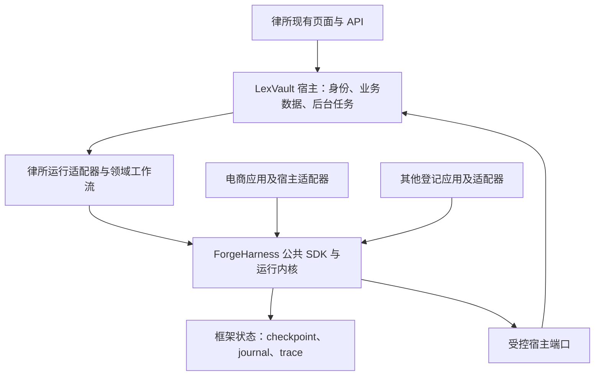

# LexVault → ForgeHarness 框架替换计划书

编制日期：2026-10-21

版本：1.0（实施提案）

状态：总体路线提案；M0/M1 后续已有实现，M2 离线工程接入见[2026-10-22 实施记录](../history/migration/m2-engineering-20261022.md)；初次检查见[现状检查与改进计划](../history/migration/status-and-improvement-plan-20261021.md)。本文的“当前基线”“拟新增”和估算保留初稿时点，不表示完整迁移或业务验收已经完成。

适用项目：LexVault「本地律所」与 ForgeHarness「多agent协作」；电商作为第二个实际应用验证对象，其他项目在启动阶段登记。

## 1. 项目目标与完成定义

将 ForgeHarness 建设为统一的 Agent 运行底座，使 LexVault、电商及后续实际项目通过公开 SDK、领域模块和宿主适配器接入。公共运行机制在框架中维护，各项目继续拥有自己的业务规则、数据库、身份认证和产品界面。

本计划以**完成替换**为目标，分阶段验证和切换。只读试点是中间里程碑；迁移不能停留在演示或长期维护三个同等地位的运行时。

| 交付结论 | 完成条件 |
| --- | --- |
| 律所只读链路接入 | 原有专家和检索通过适配器运行于 ForgeHarness；授权、引用、失败与结果契约通过；原宿主零写入 |
| 律所运行框架替换 | 新任务默认由 ForgeHarness 执行；业务落库、后台任务、轨迹、恢复及桌面/移动页面通过验收；旧运行安全退出 |
| 框架具备跨项目复用能力 | 法律与电商两个实际宿主共用同一框架发行线；通过适用的共同契约测试；核心无行业专属分支 |
| 所有实际项目完成统一 | 启动阶段登记的每个项目都有接入记录、锁定版本、业务验收和旧路径处置结果；两个应用通过不能代替全部项目通过 |

统一范围是框架接口、运行治理、交付规范和升级机制。各应用可以使用确定性函数、固定 DAG、单 Agent 或多 Agent；按任务需要组合，不强制相同模型、数据库或工作流。

## 2. 当前基线与差距

以下为 2026-10-21 的源码和配置阅读结果。本次未重跑业务测试、模型评测或历史报告中的门禁。

| 项目 | 已有基础 | 替换前需要补齐 |
| --- | --- | --- |
| LexVault 0.3.0 | 原生 DAG 与 LangGraph；事实、证据、矛盾、疏漏、法条节点；混合检索；案件权限；审计；后台任务；LangGraph 失败续跑 | 公共运行接口、ForgeHarness 适配、运行 ID 映射、状态投影、前端兼容及新路径验收 |
| ForgeHarness 0.5.0 源码及未发行改动 | 公开 SDK、Capability、Orchestrator、只读 RunKernel、模型调用共享核心；ReAct 路径已有审批/journal/恢复 | 自定义编排的共享工具执行、挂起/恢复、并行状态协议及完整适用契约 |
| 法律接入原型 | SQLite 只读导出、CaseBundle、并行 DAG、页身份与摘要、可选严格引文校验 | 现有 DAG 是词匹配原型；需接原专家、混合检索、宿主实时授权及完整产品入口 |
| 既有验证 | 有脚本模型只读链路记录及跨应用契约子集 | 不能据此声称法律质量、完整恢复、真实界面或全部项目已通过 |
| 运行环境 | LexVault 声明 Python 3.11–3.14；ForgeHarness 声明 Python ≥3.12、<3.14 | 首期使用独立 Python 3.12 进程和锁定环境，保留宿主兼容范围；同进程嵌入另行验证 |
| 版本控制 | 当前两个目录均未识别为 Git 仓库 | 保存可复现源码清单；核实原仓库来源，恢复或经明确授权建立 Git 基线；不得伪造历史或整体收录运行数据 |

实施应复用 ForgeHarness 的[剩余完善与验收计划书](/Users/xiaoy/Documents/多agent协作/docs/REMAINING_WORK_PLAN_2026-10-20.md)。其中 R1/R2 对应共享工具执行与自定义恢复，R3 对应共同契约，R4/R6 对应律所宿主及质量验证，R7/R8 对应版本与冻结交付。本计划补充 LexVault 的完整产品切换、业务状态、回滚和旧运行时退出；两份计划中的同一工作只实施和计费一次。

## 3. 替换范围与职责

| 责任归属 | 具体内容 |
| --- | --- |
| ForgeHarness 核心 | 模型/工具调用准入、预算、deadline、策略执行、工具审批执行资格、调用日志、checkpoint、编排恢复、运行事件和验证机制 |
| LexVault 领域模块 | 规划规则、事实/证据/矛盾/疏漏/法条节点、检索策略、引用语义、律师复核提示、草稿记忆准入与业务验收器 |
| LexVault 宿主 | 当前登录主体与案件权限、源文档和业务数据库、证据审批事实、会话/结果展示、导出、文件与备份、页面及原有导入队列 |
| 适配层 | 可信运行上下文、读页/检索/业务写入端口、版本映射、运行状态投影和历史访问授权 |

原有 FastAPI、页面、卷宗数据库、法条语料和导入系统继续服务业务。框架与业务数据库分别拥有清晰的状态职责，不通过复制一份律所程序到框架目录实现统一。

工具执行审批与律师对证据的业务审批分别建模：框架审批控制某次调用能否执行，业务审批控制证据是否被确认。迁移保持现有权限和审批要求；不默认给每次内部结果保存增加人工确认。

首轮不包含：改变法律判断标准、替换现有模型/检索策略、生产多租户或分布式平台、全量数据搬库、重做产品 UI、支付退款等新增业务。遇到真实兼容缺口按独立工作包解决，并更新验收范围。

## 4. 目标结构与版本管理

首期采用独立 Python 3.12 进程，通过版本化本机协议通信。接口默认使用 Unix socket 或经认证的回环连接；不得仅凭“来自本机”接受主体或案件范围。实现前冻结协议、进程生命周期、消息大小、超时和故障语义，关闭任意模块导入、任意 SQL 和任意文件访问入口。

框架以不可变 wheel/源码发行物提供，记录版本、源码摘要、依赖锁、SDK/事件/持久状态版本。各应用锁定经过自身验收的发行物，记录兼容矩阵。可短期并存相邻受支持版本，升级通过应用回归后推进，避免永久分叉。

不得在正式部署中依赖开发机绝对路径或直接修改框架安装目录。应用升级时核验发行物摘要；框架修复通过新发行物传播。新增行业能力优先留在领域包；至少两个实际应用需要、且契约稳定后再考虑进入公共层。

### 4.1 首期接口契约

以下名称为拟议接口，需在 M1 固化，不表示当前已存在。

| 契约 | 必须携带或保证的内容 |
| --- | --- |
| RunRequest | 协议版本、幂等 request_id、可信 actor/scope、case_id、应用/框架版本、数据快照版本、模型配置、预算、执行模式 |
| HostReadPort | 授权后的检索、读页、证据目录、记忆快照、法条检索；固定字段、大小和超时；每次访问重新检查当前权限 |
| HostWritePort | 精确业务动作、源版本、稳定幂等键、执行回执和结果查询；由宿主完成事务和权限检查 |
| RunEvent | 外部 run_id、单调事件序号、稳定节点 ID、事件版本、状态、耗时、用量和诊断；允许去重和补拉 |
| RunResult | answer、citations、route、plan、steps、retrieval_metrics、validation、llm_used、fallback_reason、runtime、resumable 等原有结果语义 |
| RuntimeControl | start/inspect/resume/status；恢复能力按实际实现声明，未知执行结果不得伪装为失败或成功 |

保留源 document_id、原始页码与框架引用编号之间的映射，覆盖多个文档相同页码场景。现有 bundle 最多 100 页，只能作为试点限制；正式接入必须支持约定的案件规模，或在产品入口明确拒绝超限，禁止静默截断。分页/分批后必须保持引用身份和快照一致。

使用现有 bundle 校验器的试点显式设置并冻结 `strict_quotes=True`。若为保持原产品引用格式而使用领域适配校验器，必须提供等价的逐引用原文/身份校验，并为两种格式映射补回归；不能只切换提示词或依赖默认的页号检查。

### 4.2 状态与副作用所有权

- 框架拥有执行状态和恢复依据；LexVault 的运行/步骤表用于业务展示与关联，以事件形成幂等投影，不能成为第二套独立调度状态机。
- 用映射表关联宿主 run_id、框架 run_id、runtime/version 和 request_id；相同请求重试不得创建第二次业务运行。
- 明确后台 job 与 run 恢复后的收敛：当前恢复接口主要恢复 run，并未在该入口完成原 job/会话闭环。新路径通过幂等完成回执同步 job 终态，并按原业务约定创建或关联唯一会话；同一完成事件重复送达不得重复生成消息。队列满、提交失败、取消及 worker 重启也须有确定的终态和配额释放规则。
- 源文档、证据、疏漏、会话和记忆仍由宿主写入。每类写入单独明确触发条件、权限、唯一键、事务和回执；框架不能直接修改业务表。
- 宿主 DB 与框架 DB 之间不假设跨库原子提交。采用持久事件/回执、可重试投影和对账；工具超时且副作用未知时先查询结果，不能直接重放或改走旧运行时。
- 并行节点采用持久的节点进度协议和单运行写者约束；恢复还原的是已声明的状态，不是任意 Python 协程或线程。
- 当前领域代码中的直接模型调用要通过框架模型端口；embedding/reranker 调用通过受控检索端口记录实际后端、耗时、失败及可获得的用量，避免治理被旁路。
- checkpoint、trace、记忆和导出统一纳入案件权限、撤权与保留/删除规则；哈希链只能证明声明范围内的完整性，不等同外部防篡改审计。

## 5. 阶段、交付物与退出条件

人日为熟悉项目的开发者粗估，包含实现、必要测试与文档，不含等待接口、领域评审及观察期。M0 后按基线和协议重新估算；以下工作包与框架 R0–R8 去重管理。

| 阶段 | 任务与交付物 | 依赖 | 退出条件 | 粗估 |
| --- | --- | --- | --- | --- |
| M0 基线与范围 | 登记全部实际项目；保存两侧源码/锁文件摘要；登记既有失败；冻结业务行为、数据规模、评分和预算；建立回滚基线 | 无 | 可重建旧系统；区分历史证据与本轮证据；项目清单、负责人和指标有记录 | 1–2 人日 |
| M1 公共接入契约 | 固化 RuntimeControl、宿主端口、事件/结果、身份和版本契约；构建锁定框架包；先用旧运行时实现兼容接口 | M0 | 旧流程回归通过；安装不依赖开发目录；核心不导入具体业务 | 2–4 人日 |
| M2 律所只读真实链路 | 接原专家、混合检索和受控法条；实现受授权导出/读端口；运行隔离的新旧对照；输出来源和差异报告 | M1；复用现有只读 kernel | 在真实宿主接口下跑通；源宿主零写入；引用和隔离门槛通过；明确仅是只读接入 | 4–7 人日 |
| M3 工具与自定义恢复 | 复用框架 R1/R2；抽共享工具执行器；接审批、journal、幂等、并行预算与节点恢复；故障注入 | M0 后设计；依赖稳定契约 | 自定义编排支持声明的写入/挂起/恢复；重启和撤权用例通过后解除对应限制 | 9–15 人日 |
| M4 完整律所产品接入 | 接业务落库、后台任务、同步 API、轨迹、恢复、桌面/移动页面；状态投影与删除/保留；部署及健康检查 | M2、M3 | 隔离 HTTP/UI 真实流程通过；原有业务能力无缺项；运行进程确认加载候选代码 | 4–7 人日 |
| M5 冻结与业务验收 | 完整 CI、构建安装、领域盲评、成本/时延及故障报告；审查 blocker/high；干净副本复验 | M4；数据准备可提前 | 工程、业务质量和运行验收分别有结论；未通过项不能以平均分抵消 | 4–7 人日 |
| M6 切换与退役 | 备份/恢复演练；按案件或主体小范围试点；观察后切新任务默认；处置旧运行与依赖 | M5 | 新默认稳定；回滚演练通过；旧任务有归宿；移除重复路径的门槛满足 | 2–4 人日 + 观察期 |
| M7 第二实际应用与推广 | 复用框架 R5；电商真实宿主最小闭环；同版核心和共同契约；形成新项目接入模板及逐项目排期 | M1 后可并行；最终依赖稳定发行物 | 法律/电商均通过各自验收；其他登记项目逐项完成，不用样例代替真实宿主 | 5–8 人日；其他项目另估 |

初始两应用范围合计约 **31–54 人日**，单人约 6–11 个工作周，另计专业复核等待、观察期及其他项目接入。首个只读里程碑 M0–M2 约 7–13 人日。该估算包含复用的框架工作，不能再与框架总计划相加。多 Agent 可并行帮助代码阅读、测试和审查；跨库协议、恢复语义与最终集成仍有串行依赖，不按 Agent 数量直接折算工期。

建议里程碑顺序：先达到 M2，再完成 M3/M4 的完整能力，随后 M5/M6 放行。M2 成功不提前切换全部用户。

### 5.1 LexVault 改动清单

| 位置 | 计划改动 |
| --- | --- |
| `app/agents.py` | 分离领域节点与调度/持久化；保持规则结果；显式注入模型、检索、记忆与结果存储端口 |
| `app/langgraph_agents.py` | 过渡期保留历史运行恢复；退出前验证任务归属和版本，不将旧 checkpoint 直接交给 ForgeHarness |
| `app/review_jobs.py` | 使用公共运行接口和 run_started 事件；替换对私有 `_start_run` 的临时修改；持久关联请求与运行；固定可信身份及数据作用域 |
| `app/main.py` | 同步入口、后台入口、inspect/resume、对照入口统一调度；保留既有请求/结果兼容；错误返回准确的恢复能力 |
| `app/db.py` | 仅按需新增映射/投影/回执及迁移；保留历史行和原 runtime，确保旧版本回滚兼容性经过测试 |
| `app/agent_tools.py`、`app/rag.py`、`app/services.py` | 通过宿主端口复用；维持案件权限、受控模型端点、原检索与业务校验 |
| `app/static/app.js`、`app/static/mobile.js` 及相关 HTML | 按服务端能力展示运行、错误、进度与恢复；不把 LangGraph 专属字段当成所有运行的恢复依据 |
| 拟新增 `app/runtime_ports.py`、`app/forge_runtime.py` | 放置协议和适配器；具体拆分在 M1 确认，当前不宣称已存在 |
| 依赖、部署、CI、运维与发布清单 | 锁定宿主与独立框架环境；增加协议/集成检查；退出旧运行时后再清理依赖与许可证清单 |

### 5.2 只读对照的特别约束

当前 `LawReviewCoordinator.process_query(..., persist_memory=False)` 仍会写运行/步骤记录及疏漏结果；现有 API 对照入口也不能被当成零写入实验器。

M2 使用隔离数据库/目录与授权快照：旧实现运行于隔离副本，新实现通过只读端口运行，实验产物保存在独立私有目录。禁止直接在真实业务库上靠关闭记忆写入完成“只读”对照。运行后检查源数据、表级副作用及文件访问；活跃 SQLite 的文件哈希变化不能单独归因实验，应在一致快照/停写条件下核验，并结合只读连接和访问记录。

现有 `execute_readonly_tool` 也会写入 `audit_log`；M2 不直接调用会写源库的读工具。试点必要审计保存于隔离实验存储，业务源库只通过只读连接访问。M4 正常业务运行再恢复经过验收的宿主审计写入，不能把试点隔离方式当作正式运行省略审计的理由。

对照固定相同问题、检索结果、记忆快照、专家输入与模型配置，先验证编排和结果契约；另设完整检索链路对照评估端口接入。不得让第一条路径产生的记忆进入第二条路径，或用不同资料版本比较后将差异归因框架。

## 6. 验收矩阵

所有用例绑定源码、依赖、应用/框架版本、模型配置、数据快照和评分版本；下表是待执行要求。

| 维度 | 必测场景 | 放行要求 |
| --- | --- | --- |
| 领域等价 | 事实、证据、矛盾、疏漏、法条、空材料；显式离线与模型失败路径 | 确定性节点结果按规范化契约一致；降级/拒绝不伪装模型成功；原业务规则无遗漏 |
| 检索与引用 | 多文档同页码、邻页、长案、精确引文、内容变化、撤回、缺失法条 | 来源映射和精确引文在适用样本中 100% 可定位；失效引用不获成功；语义支持单独专业复核 |
| 身份与范围 | 跨案件/租户/页、伪造主体、后台身份丢失、运行中撤权、历史 inspect/导出 | 未授权数据泄漏和副作用均为 0；后台及恢复重新检查当前授权 |
| 工具与审批 | 非法参数、修改参数/版本、批准过期/复用、策略拒绝、结果未知 | 越权、未批准和重复业务副作用均为 0；未知结果有查询/对账路径 |
| 编排与恢复 | 并行失败、join、预算竞争、进程重启、完成后落盘前故障、写入后回执丢失 | 每个故障窗口有明确可恢复/终止/待核对结果；已完成节点不重复产生结果；累计预算不丢失 |
| 后台与产品 | 提交、轮询、刷新、超时、失败提示、真实恢复、桌面/移动引用跳转 | 真实 HTTP/UI 流程通过；状态与实际执行一致；非恢复运行不显示可恢复按钮 |
| 数据生命周期 | 草稿记忆、证据审批、重复结果投影、案件删除/归档、备份恢复 | 不把草稿升级为确认事实；不重复写记忆/疏漏；各持久副本有明确访问和保留策略 |
| 兼容与规模 | 旧请求、旧 run、协议不匹配、100 页以上案件、长文本、模型不可用 | 拒绝/分批/迁移行为明确；不得静默截断或错读旧状态；覆盖 M0 冻结的实际规模 |
| 发布与回滚 | 干净安装、依赖导出、发布白名单、停止 sidecar、回滚后历史读取 | 可重建旧/新部署；私有数据不入源码包；恢复演练有证据 |
| 跨应用复用 | 法律、电商及后续项目的适用共同契约 | 核心无业务分支；不适用项注明理由；真实接口和模拟接口分别报告 |

### 6.1 业务质量与性能口径

先以开发集 8 题进行链路试点；终评至少覆盖原计划的 16 个独立业务题，并补齐上表的异常与规模场景。题数只是最低试点规模，不代表生产泛化或统计充分性。开发集与终评材料分开；重复运行不增加独立案件数。

在终评前冻结模型、问题、可用证据范围、评分细则和判断门槛，尽可能盲评；必要时每题重复 3 次，分别报告平均、最差和失败次数。主对照使用当前原生路径，恢复能力单独与 LangGraph 路径对照；框架变化与模型/检索变化分开实验。

建议待 M0 冻结的放行口径：

- 权限泄漏、未批准/重复副作用、虚假完成、引用身份错误：适用验收集零失败；任何一项失败均阻断切换。
- 确定性节点和结果结构：契约一致；关键业务题不得出现新增严重错误。
- 真实模型质量：专业量表总分不低于基线，并逐题检查回退；原文匹配不替代结论被证据支持。
- 时延：相同模型、材料和并发条件下，建议 p95 不超过基线的 1.20 倍；样本不足时报告原始分布，不宣称稳定 p95。
- 用量：相同业务链路实际 token 建议不超过基线的 1.10 倍；新增治理/校验开销分别列出；无法取得实际值时标为未知。
- 最终绝对超时、最大案件规模和费用限额在 M0 填入验收记录。上述相对值是预算提案，不是当前测量；不得看到终评结果后降低门槛。

工程通过、模型质量通过和业务试点通过分别出具结论。未安排真实模型或专业评审时，业务质量保持未验收。

### 6.2 工程检查要求

LexVault 以当前 [CI 配置](../../.github/workflows/test.yml)、[工程配置](../../pyproject.toml) 和 [AGENTS.md](../../AGENTS.md) 为准：

- Python 3.11/3.14 宿主矩阵、锁定安装、依赖检查、两份 requirements 导出一致性、doctor、compileall、Ruff、mypy。
- 前端脚本语法检查；实际桌面/移动流程必须对确认加载候选代码的服务执行。
- 隔离数据和 checkpoint 目录；禁网离线测试包含 `tests` 及 CI 列出的三个工程脚本；显式插件、分支覆盖率和原始报告参数保持一致。
- 保持现有 70% 覆盖率门槛，执行发布清单检查；不得通过删测试或放宽断言放行。

ForgeHarness 以其 [Makefile](/Users/xiaoy/Documents/多agent协作/Makefile)、[CI](/Users/xiaoy/Documents/多agent协作/.github/workflows/ci.yml) 和剩余计划 R0/R3/R8 为准：保留全范围格式、lint、类型、覆盖率/分支门禁、keyless 控制评测、锁一致性、构建/最小安装与候选冻结审查。当前旧候选输出路径需先按 R0 修正，不能覆盖旧证据；历史测试数量不作为本轮预期值。

跨进程集成使用合成/获准脱敏数据、隔离数据库和独立进程。离线测试与需要网络的依赖审计、真实模型评测分开运行和报告。沿用现有模型外发控制；本计划本身不授权付费调用、真实材料外发或生产部署。

## 7. 切换、回滚与旧运行时退出

### 7.1 切换流程

1. 冻结候选、保存兼容的旧发行物和两侧依赖；按现有停写备份流程备份业务数据及关联状态，并完成一次隔离恢复演练。
2. 先为指定测试主体/案件启用 ForgeHarness；选择对同一 request_id 和 run_id 固定，不让重试落到另一运行时。
3. 建议观察至少 5 个工作日并完成不少于 20 次覆盖主要流程的有效运行；该下限是试点建议，需在 M0 冻结，不能替代 M5 验收。
4. 达到观察门槛后将新任务默认切到 ForgeHarness。历史运行继续按保存的 runtime/version 读取或处理，记录切换时间及范围。
5. 再完成一个预先确定的观察窗口，核对未决任务、失败分布和资源使用后进入退役。

### 7.2 触发回滚与执行步骤

出现跨范围访问、重复/未批准写入、错引来源、结果丢失、错误恢复或持续突破已冻结的性能限额，暂停新路径准入并记录影响范围。

回滚步骤：关闭新运行准入 → 盘点 queued/running/待审批/副作用未知的任务 → 停止或排空相应 worker → 核对 journal 与宿主回执 → 仅将确定未执行的新请求切回旧运行时 → 校验旧服务及页面 → 保留新路径证据用于修复。

不能因超时自动重跑整个案件；不能把副作用未知任务直接发给原生路径；不能通过覆盖当前业务库回退而丢失切换后的合法业务数据。原则上应用/配置回滚配合兼容的增量 schema；若确需数据恢复，先形成对账与前向数据保全方案，再按既有授权执行。

### 7.3 原生与 LangGraph 的退出条件

- 原生实现保留为有限期对照与回滚参考；稳定期结束后停止在线新任务入口。
- 旧 LangGraph checkpoint 不直接转换为 ForgeHarness checkpoint。盘点后选择在原版本完成、授权终止并重开新 run，或归档为不可恢复历史记录。
- 只有在无未决旧任务、历史展示可用、回滚窗口结束、替代恢复功能通过后，才删除在线旧调度代码、依赖和专属页面入口。
- 历史结果、审计和受保留政策约束的 checkpoint 不因退役自动删除。版本化归档与离线读取方式列入交付。
- 最终在线主路径只有一个；继续保留例外运行时必须有具体用途、责任人和退出日期。

## 8. 责任、依赖与风险

| 角色 | 负责事项 |
| --- | --- |
| 项目负责人 | 冻结项目清单、范围、数据使用、预算与验收指标；批准业务切换窗口 |
| 框架维护者 | R1/R2 公共执行与恢复、版本契约、安装和共同门禁 |
| 律所集成人员 | 原领域行为、宿主权限、接口、落库、前端与部署适配 |
| 验证/审查人员 | 隔离测试、故障注入、冻结与干净复验；问题分类及回归 |
| 律师/业务评审人 | 证据支持、事实与法律质量、错误严重性和实际流程验收 |

角色可由同一人承担，但自审、自动化检查与独立专业评审应如实区分，不伪称独立认证。

| 主要风险 | 应对与停止条件 |
| --- | --- |
| 自定义恢复尚未完成 | M2 可先做；M3 未通过不进入完整替换，不绕开框架复制一套恢复逻辑 |
| 接原型造成业务退步 | 以原专家和真实检索适配为验收对象；词匹配样例只作控制流回归 |
| 身份或资料失效信息丢失 | 每次宿主访问和恢复重新授权；结果/历史读取检查当前权限与资源版本 |
| 双库状态不一致 | 单一执行状态来源、幂等投影、回执查询与对账；未知状态禁止盲重放 |
| 框架过度泛化 | 用法律与电商的真实需求约束扩展；其他项目先登记再估算 |
| 版本、源码与历史报告错配 | 两项目摘要与发行物统一记录；候选变更重新冻结，旧报告仅作历史证据 |
| 原仓库元数据缺失 | 先保存可复现清单和文档；恢复/初始化 Git 单独处理，不为提交计划书把全部现有文件纳入仓库 |

遇到验收失败时修复并重新验证，迁移阶段保持未完成；不把“已提取少量能力”写成“完整替换”。确需调整目标或范围时保留决策记录及影响。

## 9. 交付清单与第一批实施任务

最终交付至少包含：

1. 不可变 ForgeHarness 发行物、SDK/协议/状态版本及兼容矩阵。
2. LexVault 运行适配器、领域工作流、宿主端口、ID 映射与幂等状态投影。
3. 完整后台/API/桌面/移动流程及能力准确的恢复入口。
4. 共同契约与法律专项测试、隔离数据夹具、故障矩阵和真实业务评审记录。
5. 与源码绑定的工程/模型/业务报告，含失败、未知项与残余风险。
6. 部署、健康检查、备份/恢复、回滚、历史运行处理及退役说明。
7. 第二实际应用接入证据、新项目模板，以及全部登记项目的迁移台账。

第一批实施限定为 M0/M1：登记范围与来源 → 保存旧行为基线 → 固化公共运行和宿主端口协议 → 让旧运行时先实现接口 → 形成第一个可独立验证的变更。每个主题在验证后原子提交；框架与宿主的提交/发行摘要通过迁移台账关联。Git 前置条件未解决时，记录源码摘要和具体未提交原因，不伪造提交哈希。

当前文档交付不启动迁移、不触碰真实案件库、不切换运行时。实施前需要落实的外部条件为：可复现源码基线、获准的测试数据与身份、可用模型环境、业务评审人及具体试点范围。

## 10. 依据与状态入口

- [LexVault 系统架构](system.md)、[策略基线](strategy-baseline-20260914.md)。
- [原生领域节点与协调器](../../app/agents.py)、[LangGraph 运行时](../../app/langgraph_agents.py)、[后台任务](../../app/review_jobs.py)。
- [ForgeHarness 当前状态](/Users/xiaoy/Documents/多agent协作/docs/STATUS.md)、[框架路线](/Users/xiaoy/Documents/多agent协作/docs/FRAMEWORK_STRATEGY.md)、[剩余完善与验收计划书](/Users/xiaoy/Documents/多agent协作/docs/REMAINING_WORK_PLAN_2026-10-20.md)。
- [自定义编排内核](/Users/xiaoy/Documents/多agent协作/src/forgeharness/sdk/kernel.py)、[Harness 控制入口](/Users/xiaoy/Documents/多agent协作/src/forgeharness/sdk/harness.py)、[法律原型](/Users/xiaoy/Documents/多agent协作/src/forgeharness/applications/legal/lexvault/dag.py)、[只读导出器](/Users/xiaoy/Documents/多agent协作/src/forgeharness/applications/legal/lexvault/exporter.py)。

ForgeHarness 链接指向本机配套项目，向其他环境交付时需同时提供对应版本的源码或文档。历史计划存在阶段性描述，以源码、最新状态入口和本轮冻结证据为准。
